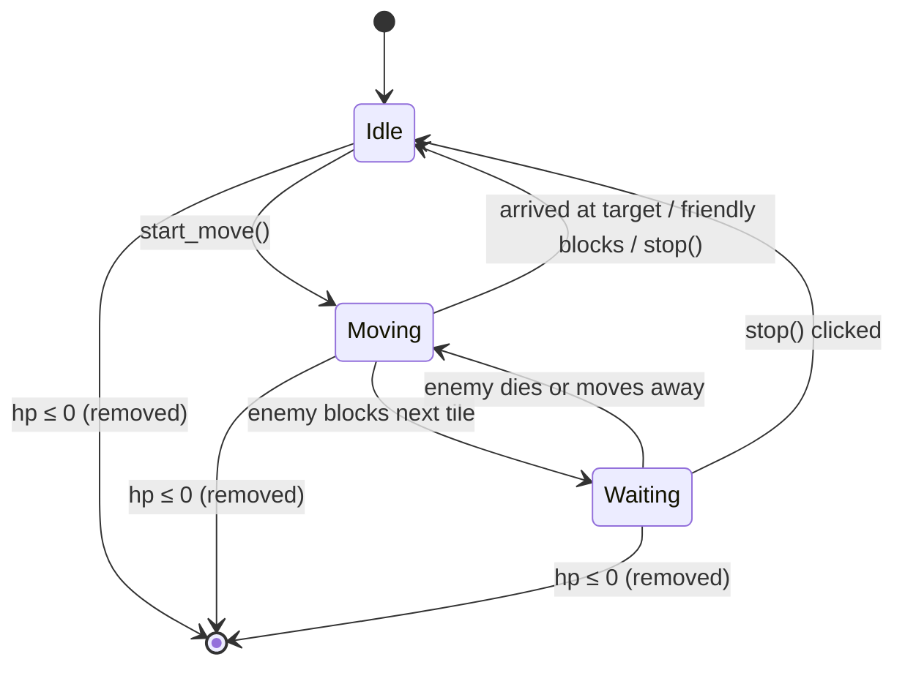
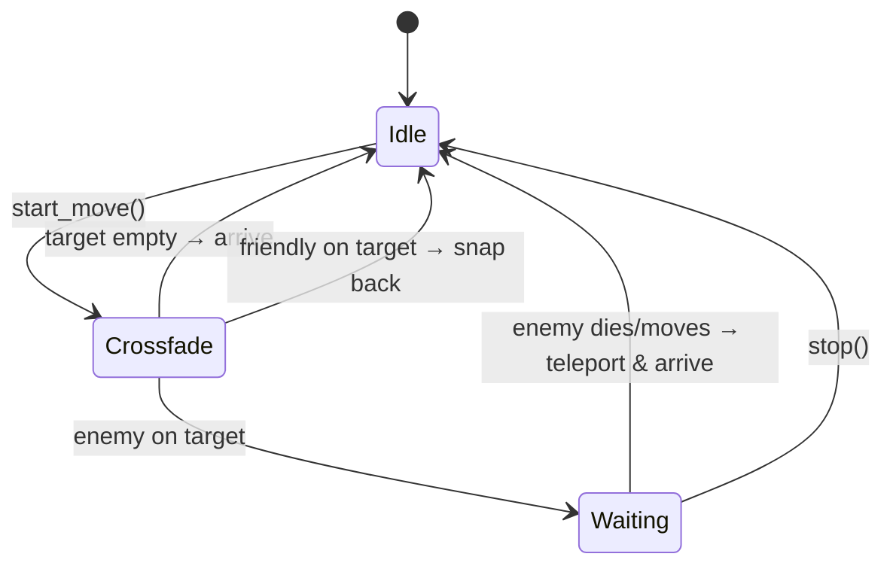
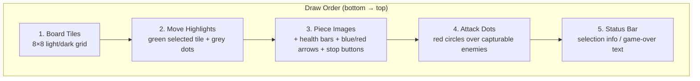
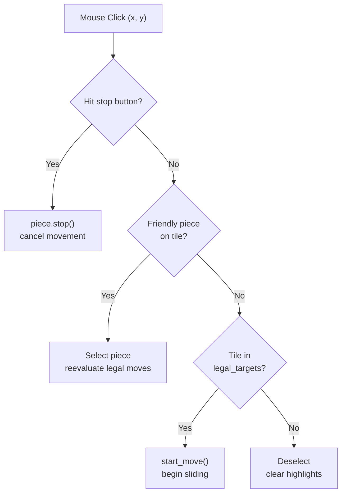
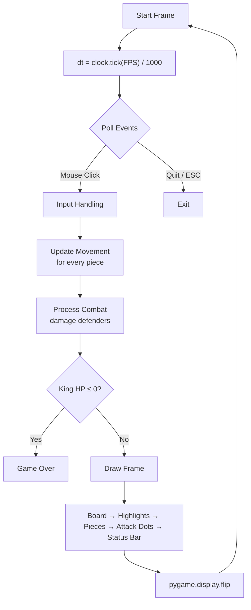

# Real-Time Chess — Architecture

## Overview

A real-time strategy (RTS) board game built with **Python** and **Pygame**. Two players share a single 8×8 board with chess-like pieces, but there are no turns — all pieces can move simultaneously. Pieces have hit points and deal damage when attacking, and the game ends when a king reaches 0 HP.

Everything resides in a single file: **ChessGame.py**.

---

## Constants & Configuration

| Constant | Value | Purpose |
|---|---|---|
| `TILE` | 100 px | Size of one board square |
| `BOARD` | 8 | Number of rows/columns |
| `FPS` | 60 | Frame rate cap |
| `PIECE_SPEED` | 0.2 tiles/sec | Uniform movement speed for all pieces |
| `DAMAGE_PER_SECOND` | 10 | HP removed from the defender each second |
| `STOP_BTN_RADIUS` | 10 px | Clickable radius of the stop button |

### HP Table

| Piece | HP |
|---|---|
| Pawn | 100 |
| Knight | 300 |
| Bishop | 300 |
| Rook | 500 |
| Queen | 1000 |
| King | 5000 |

---

## Assets

Piece images are loaded from the `pieces/` folder:

```
pieces/
  Bishop/   black.png, white.png
  King/     black.png, white.png
  Knight/   black.png, white.png
  Pawn/     black.png, white.png
  Queen/    black.png, white.png
  Rook/     black.png, white.png
```

`load_piece_images()` reads every PNG at startup and scales them to `TILE × TILE`.

---

## Piece Class

The central data structure. Each `Piece` instance holds:

### Identity
- `color` — `"white"` or `"black"`
- `name` — `"Pawn"`, `"Knight"`, `"Bishop"`, `"Rook"`, `"Queen"`, `"King"`

### Position
- `col`, `row` — current logical tile (updated tile-by-tile during movement)
- `pixel_x`, `pixel_y` — sub-tile pixel position for smooth rendering
- `origin_col`, `origin_row` — tile where the current move started

### Health
- `hp` / `max_hp` — current and starting hit points
- `alive` — `False` once `hp` reaches 0

### Movement State
- `moving` — whether the piece is in transit
- `target_col`, `target_row` — final destination tile
- `path[]` / `path_index` — list of intermediate waypoints; the piece advances one tile at a time, freeing the previous tile immediately
- `waiting` — `True` when the next tile is blocked by an enemy (piece stays centered on its own tile, deals damage via the combat system)
- `attack_target` — reference to the defender being attacked (used by pawns to check if a diagonal capture succeeded)

### Knight-Specific
- `knight_phase` — `None`, `"crossfade"`, or `"waiting"`
- `knight_alpha` / `knight_dest_alpha` — opacity at origin / destination during crossfade
- `knight_timer`, `knight_duration` — animation timing

### Key Properties
- `current_tile` → `(col, row)`
- `next_tile` → the waypoint the piece is heading towards (or `None`)

---

## Movement System

### Piece State Machine



### Sliding Pieces (all except Knight)

`_update_slide(dt, pieces)` runs every frame:

1. Look up the next waypoint `(wc, wr)` from `self.path[self.path_index]`.
2. **Blocker check first** — before moving any pixels, call `_get_blocker()`:
   - **Enemy blocker** → snap to current tile center, set `waiting = True`. The piece is now "attacking" (combat system deals damage). A **red arrow** is drawn from the piece's tile to the enemy's tile.
   - **Friendly blocker** → cancel movement entirely.
   - **Pawn forward blocked** → always cancel (pawns can only attack diagonally).
3. If no blocker (tile is free):
   - If pawn was waiting diagonally and the defender survived (moved away), cancel — pawn doesn't move diagonally on a failed capture.
   - Otherwise, interpolate `pixel_x`/`pixel_y` toward the waypoint.
   - On arrival, advance `col`/`row` to the waypoint and increment `path_index`. The old tile is immediately freed.

### Knight

`_update_knight(dt, pieces)` uses a **simultaneous crossfade**:



1. **`"crossfade"` phase** — origin copy fades out (alpha 255→0) while destination copy fades in (alpha 0→255). Both are drawn concurrently.
2. At the end of the crossfade:
   - **Enemy on target** → enter `"waiting"` phase (invisible, arrow drawn, damage dealt).
   - **Friendly on target** → snap back to origin, cancel.
   - **Empty target** → arrive, finish move.
3. **`"waiting"` phase** — once the target clears, teleport to destination and finish.

### Stop Button

Every moving piece shows a small **red circle with a white X** in its top-right corner. Clicking it calls `piece.stop()`, which snaps the piece to its current logical tile and cancels all movement state.

---

## Combat System

`process_combat(pieces, dt)` — called every frame after movement updates.

**One-directional damage**: only the **defender** takes damage. For each moving piece (the attacker), if its `next_tile` matches any enemy piece's `current_tile`, the defender loses `DAMAGE_PER_SECOND × dt` HP. When HP ≤ 0, the piece is removed (`alive = False`).

The attacker is never damaged.

---

## Move Generation

`get_legal_targets(piece, pieces)` computes valid destination tiles following chess rules:

| Piece | Movement Pattern |
|---|---|
| Pawn | Forward 1 (or 2 from start); diagonal capture only if enemy present |
| Knight | L-shape jumps |
| Bishop | Diagonal slides |
| Rook | Orthogonal slides |
| Queen | All 8 directions (slides) |
| King | 1 square in any direction |

### Blocking Rules
- `tile_blocked_by_own()` — a tile with a friendly piece (stationary or in-transit target) is blocked.
- `_pawn_path_clear()` — pawn forward moves require no piece of either color on the target.
- `_slide()` — sliding pieces stop at the first occupied tile; enemy tiles are added as attack targets, friendly tiles block.

---

## Rendering Pipeline

Layers are drawn bottom-to-top:



Each frame follows this order:

1. **Board** — `draw_board()` paints the 8×8 grid of alternating light/dark tiles.
2. **Move highlights** — `draw_highlights()` draws a green overlay on the selected piece's tile and grey dots on reachable empty tiles.
3. **Pieces** — each `Piece.draw()` renders:
   - The piece image (with crossfade handling for knights)
   - A **health bar** at the bottom of the tile (green → yellow → red)
   - A **blue arrow** from origin to target while moving
   - A **red arrow** toward the enemy tile while attacking/waiting
   - A **stop button** (red X circle) in the top-right corner while moving
4. **Attack dots** — `draw_attack_dots()` draws semi-transparent red circles over enemy pieces that can be captured (rendered on top of piece images).
5. **Status bar** — 40 px strip below the board showing selected piece info or game-over message.

---

## Input Handling



All input is mouse-driven (left click):

1. **Stop button** — checked first; stops the moving piece.
2. **Friendly piece click** — (re)selects the piece, reevaluates legal moves.
3. **Legal target click** — initiates movement toward that tile.
4. **Empty/invalid click** — deselects.
5. **ESC** — quits the game.

Each click on a piece always reevaluates available moves based on current board state.

---

## Game Loop



The game ends when either king's HP reaches 0, displaying `"{Color} wins!"`.

---

## File Structure

```
chess/
  ChessGame.py              # All game logic in a single file
  ARCHITECTURE.md            # This document
  pieces/
    Bishop/  black.png  white.png
    King/    black.png  white.png
    Knight/  black.png  white.png
    Pawn/    black.png  white.png
    Queen/   black.png  white.png
    Rook/    black.png  white.png
```
