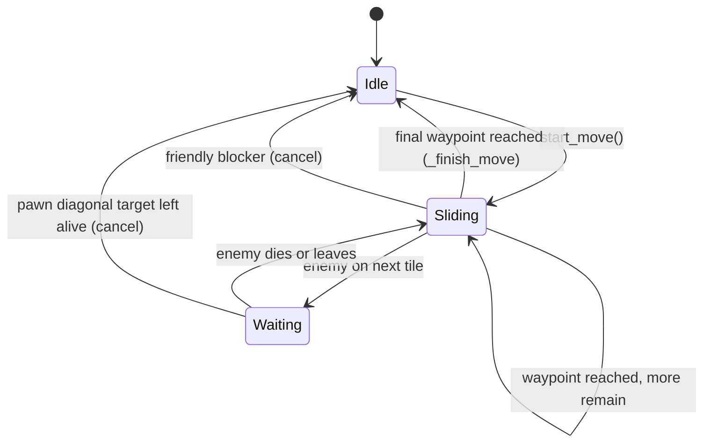
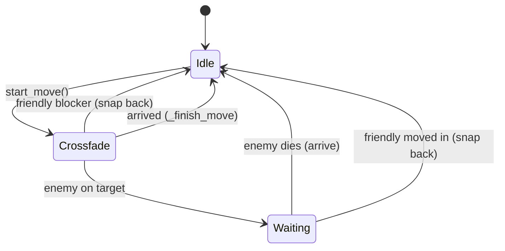
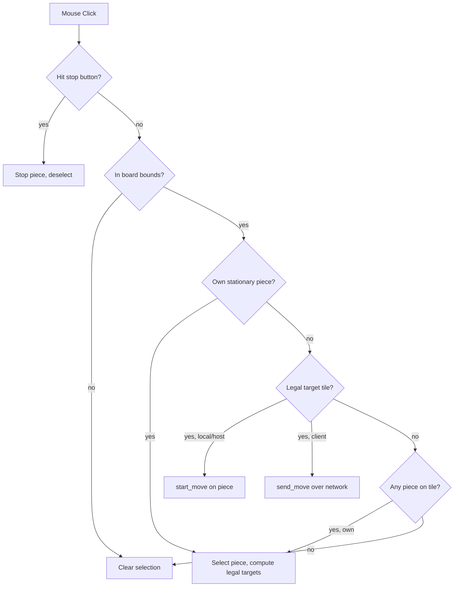
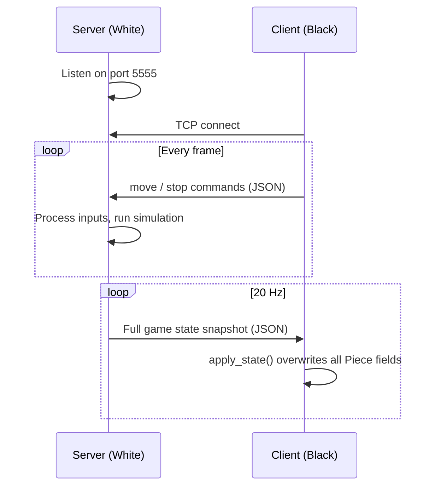
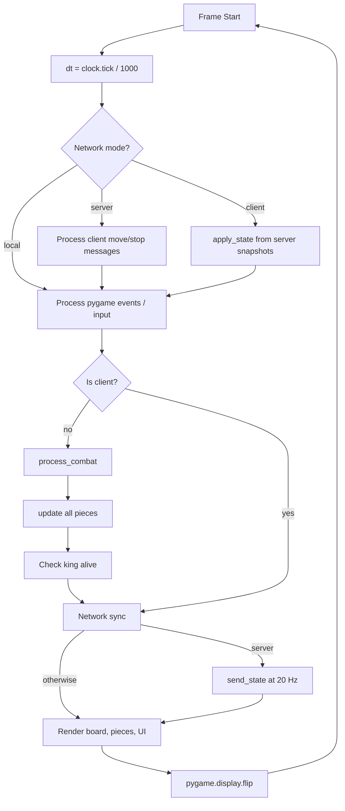

# Real-Time Chess — Architecture

## Overview

A real-time strategy board game built with **Python 3** and **Pygame**.
Two players share a standard 8×8 chess board, but there are **no turns** —
all pieces move simultaneously in real time. Pieces have hit points (HP)
and deal damage on contact. The game ends when a King reaches 0 HP.

The game supports three modes:

| Mode | Command | Description |
|---|---|---|
| Local | `python ChessGame.py` | Both colors on one machine |
| Host | `python ChessGame.py --host` | You play **white**, wait for a client |
| Join | `python ChessGame.py --join <IP>` | You play **black**, connect to host |

---

## File Structure

```
chess/
├── ChessGame.py          # Game logic, rendering, main loop
├── network.py             # TCP server/client for online play
├── ARCHITECTURE.md        # This file
└── pieces/
    ├── Bishop/            # black.png, white.png
    ├── King/
    ├── Knight/
    ├── Pawn/
    ├── Queen/
    └── Rook/
```

---

## Constants

| Constant | Value | Purpose |
|---|---|---|
| `TILE` | 100 px | Size of one board square |
| `BOARD` | 8 | Rows and columns |
| `WIDTH` | 800 px | Window width (`TILE × BOARD`) |
| `HEIGHT` | 840 px | Window height (board + 40 px status bar) |
| `FPS` | 60 | Frame rate cap |
| `PIECE_SPEED` | 0.3 tiles/sec | Uniform movement speed |
| `DAMAGE_PER_SECOND` | 10 | HP removed from the defender each second |
| `STOP_BTN_RADIUS` | 10 px | Clickable radius of the stop button |

### HP Table

| Piece | HP |
|---|---|
| Pawn | 100 |
| Knight | 300 |
| Bishop | 300 |
| Rook | 500 |
| Queen | 1000 |
| King | 5000 |

---

## Piece Class

Each piece on the board is an instance of `Piece`. It holds both logical
state (grid position, HP, alive) and visual state (pixel position, animation).

### Key Fields

| Field | Type | Purpose |
|---|---|---|
| `color` | str | `"white"` or `"black"` |
| `name` | str | `"Pawn"`, `"Knight"`, `"Bishop"`, `"Rook"`, `"Queen"`, `"King"` |
| `col`, `row` | int | Current logical grid position |
| `hp`, `max_hp` | float | Current and maximum hit points |
| `alive` | bool | `False` when HP ≤ 0 |
| `moving` | bool | Currently in motion |
| `waiting` | bool | Blocked by enemy, dealing damage |
| `attack_target` | Piece/None | The enemy being fought |
| `path` | list[(col, row)] | Waypoints from current tile to destination |
| `path_index` | int | Index into `path` for next waypoint |
| `pixel_x`, `pixel_y` | float | Smooth rendering position |
| `origin_col/row` | int | Where movement started |
| `target_col/row` | int | Final destination |
| `has_moved` | bool | Disables pawn double-step after first move |

### Key Properties

- **`next_tile`** — The tile the piece is currently heading toward (`path[path_index]`), or `None`.
- **`current_tile`** — `(col, row)` tuple.

---

## Movement System

### Sliding Pieces (Pawn, Bishop, Rook, Queen, King)

Movement uses a **tile-by-tile waypoint** system.
`_compute_path()` generates a list of tiles from origin to target.
Each frame, `_update_slide()` moves `pixel_x/y` toward the next waypoint
at `PIECE_SPEED` tiles/sec. When a waypoint is reached, `col/row` update
and `path_index` advances.



### Knights

Knights use a **crossfade animation**: the origin copy fades out while
a destination copy fades in, both simultaneously over `3 / PIECE_SPEED`
seconds. After the crossfade completes:

- **Friendly blocker** → snap back to origin, cancel move
- **Enemy on target** → enter `"waiting"` phase (invisible, dealing damage)
- **Clear** → arrive at destination



### Collision Checks (per frame)

| Check | Method | When |
|---|---|---|
| Friendly blocker | `_get_blocker()` | Before any pixel movement; checks `col/row` and `next_tile` of same-color pieces |
| Enemy on tile | `_get_enemy_on_tile()` | After friendly check; checks `col/row` and `next_tile` of opposite-color pieces |
| Stationary enemy | `_get_stationary_enemy()` | Pawns moving forward only; ignores moving enemies |
| Head-on collision | inline loop | Two enemies heading toward each other's tiles; both stop and fight |

### Pawn-Specific Rules

- **Forward movement**: Pawns move forward (same column). They only stop for
  **stationary** enemies on forward tiles (they keep sliding if attacked by a
  moving enemy). They deal **0 damage** when moving forward.
- **Diagonal attack**: Pawns attack diagonally. Shown as legal targets only
  when an enemy occupies the diagonal tile (current or `next_tile`).
- **Failed diagonal**: If a pawn waits diagonally and the defender survives
  and leaves, the pawn cancels (stays on current tile, doesn't move diagonally).
- **Double-step**: Available only if `has_moved` is `False`.
- **Path blocked**: Forward tiles also blocked by any piece's `next_tile`
  (`_pawn_path_clear` uses `include_next=True`).

### Mutual Combat

When two pieces head toward each other (head-on collision), both remain
in place and deal damage simultaneously until one dies. The survivor then
proceeds to the freed tile. Pawns moving forward are exempt from this
lock — they keep sliding instead.

---

## Combat System

`process_combat()` runs **before** movement updates each frame, ensuring
damage applies on the final arrival frame.

```
for each alive, moving attacker:
    target_tile = attacker.next_tile
    skip if attacker is Pawn moving forward (same column)
    for each alive enemy defender:
        defender_tiles = { current_tile } ∪ { next_tile if mid-slide }
        if target_tile ∈ defender_tiles:
            defender.hp -= DAMAGE_PER_SECOND × dt
            if defender.hp ≤ 0: kill defender
```

Key rules:
- **One-directional damage**: Only the defender (the piece being moved into)
  takes damage. The attacker is unharmed unless the defender is also attacking
  back (mutual combat).
- **Pawns never deal forward damage**: Skipped when `target_tile[0] == attacker.col`.
- **Damage continues during flee**: If a defender starts moving away, damage
  continues until its `col/row` actually changes (reaches the next tile).

---

## Move Generation

`get_legal_targets()` returns all tiles a piece can currently move to.

| Piece | Rule |
|---|---|
| Pawn | Forward 1 (+ 2 from start); diagonal only if enemy present |
| Knight | L-shape (8 possible squares) |
| Bishop | Diagonal slides |
| Rook | Orthogonal slides |
| Queen | Diagonal + orthogonal slides |
| King | One step in any direction |

Blocking rules:
- **Same-color pieces** block via `tile_blocked_by_own()`, which checks
  `col/row`, `target_col/row`, and `next_tile`.
- **Sliding pieces** stop at the first occupied tile. If the occupant is an
  enemy, that tile is still a legal target (attack). Tiles beyond are blocked.

---

## Rendering Pipeline

Each frame draws in order:

1. **Board** — alternating light/dark 100×100 squares
2. **Highlights** — green overlay on selected tile; grey dots on legal move
   tiles (empty only)
3. **Pieces** — sprite at `pixel_x/y`; knight crossfade draws two alpha
   copies; knight waiting draws nothing
4. **Attack dots** — red dots on legal-target tiles where an enemy is present
   (rendered on top of pieces)
5. **Per-piece overlays** (drawn by `Piece.draw()`):
   - **HP bar** — bottom of tile; green/yellow/red based on ratio
   - **Blue arrow** — from origin to target while sliding
   - **Red arrow** — from current tile to enemy tile while waiting/attacking
   - **Stop button** — red circle with white X, top-right corner of tile
6. **Status bar** — 40 px strip below board showing selection info, winner,
   or disconnection status

---

## Input Handling



In network mode, players can only select and control their own color's pieces.

---

## Networking (`network.py`)

### Architecture

The server is **authoritative** — it runs the full simulation (movement,
combat, game-over checks). The client is **display-only** — it sends input
commands and receives state snapshots.



### Protocol

Length-prefixed JSON over TCP:

```
[4 bytes big-endian uint32: payload length][UTF-8 JSON payload]
```

Maximum message size: 10 MB (sanity cap).

### Message Types

**Client → Server:**

| Type | Fields | Purpose |
|---|---|---|
| `move` | `piece_index`, `target_col`, `target_row` | Move a black piece |
| `stop` | `piece_index` | Stop a black piece |

Server validates that the piece index is valid and the piece belongs to black.

**Server → Client:**

| Type | Fields | Purpose |
|---|---|---|
| `state` | `pieces[]`, `game_over`, `winner` | Full game state snapshot |

Each piece is serialised as a dict with all fields (color, name, col, row,
hp, pixel positions, knight animation state, path, etc.). `attack_target` is
excluded (not serialisable; server handles combat).

### Classes

- **`Server`** — Creates TCP socket on `0.0.0.0:5555`, accepts one client.
  Receiver thread reads incoming messages into a thread-safe queue.
  `send_state()` broadcasts the full piece array as JSON.
- **`Client`** — Connects to host IP on port 5555. Receiver thread reads
  state messages. `send_move()` and `send_stop()` transmit input commands.
- **`piece_to_dict()` / `apply_state()`** — Serialise and deserialise all
  `Piece` fields to/from plain dicts.

### Sync Rate

State is broadcast at **20 Hz** (every 50 ms). The client renders at 60 FPS
using the last received state.

### Disconnection

Both `Server` and `Client` detect disconnection via failed `recv()` or
`send()` calls. The status bar shows "Disconnected!" when `net.connected`
becomes `False`.

---

## Game Loop



### Frame Order (Server / Local)

1. Receive network messages (server only)
2. Process pygame events (clicks on pieces, stop buttons)
3. `process_combat()` — apply damage
4. `piece.update()` — advance movement for all pieces
5. Check game-over (king HP ≤ 0)
6. Send state snapshot (server only, 20 Hz)
7. Draw everything
8. `pygame.display.flip()`

### Frame Order (Client)

1. Receive state snapshots, overwrite all piece fields
2. Process pygame events (clicks → send commands to server)
3. No local simulation
4. Draw everything from last received state
5. `pygame.display.flip()`
