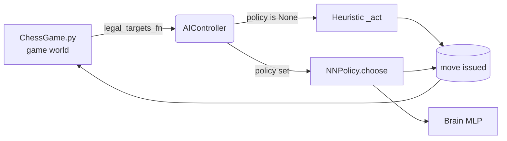

# Chapter 1 — Project Overview

> **Goal of this chapter:** give you an accurate mental model of the whole
> system before we dive into the neural network (Chapter 2) and how it is
> trained (Chapter 3). If you only care about the ML, you can skim this — but
> the AI is shaped by the game's real-time rules, so it pays to understand them.

---

## 1.1 What makes this "chess" unusual

This is **not** turn-based chess. It is a real-time strategy (RTS) game played
on a standard 8×8 board with standard piece movement *shapes*, but with three
fundamental changes:

1. **No turns.** Both colours act simultaneously and continuously. You can
   issue a command to any of your pieces at any moment.
2. **Pieces have hit points.** A capture is not instantaneous. When a piece
   reaches an enemy it *stops and deals damage over time*
   (`DAMAGE_PER_SECOND`). A Queen (high HP) can survive several hits; a Pawn
   dies quickly.
3. **Movement takes real time.** Pieces slide tile-by-tile at `PIECE_SPEED`
   tiles/sec. A move across the board is not free — it exposes the piece while
   it travels.

Real time does not mean *unlimited* speed. A **game-speed preset** sets a
**per-player move cooldown** (`SPEED_PRESETS = {fast: 1 s, medium: 3 s, slow:
5 s}`, default *medium*). You may only *commit* one move per cooldown —
selecting and inspecting pieces stays free — and a small on-screen meter shows
`READY` or a countdown. The same preset also scales piece travel speed
inversely (`PIECE_SPEED = BASE_PIECE_SPEED × 1 s / interval`), so a slower
cadence also makes pieces glide more slowly.

The game ends when a **King's HP hits zero** (King HP is 100, the same as a
Pawn — kills are about reaching the King, not grinding through a huge HP pool).

> **Why this matters for the AI:** classical chess engines reason about
> discrete, alternating turns and a finite move tree (minimax, alpha-beta,
> MCTS). None of that applies here. There is no turn to search, no clean game
> tree — just a continuous control problem where, several times per second,
> the AI must answer "which of my idle pieces should move where, *right now*?"
> That framing is what drives the design in Chapters 2 and 3.

---

## 1.2 The components

```
chess/
├── ChessGame.py     # Game world: Piece class, movement, combat, rendering, main loop
├── ai.py            # Heuristic AI controller (TORCH-FREE)
├── brain.py         # Neural-net move policy           ── TORCH
├── train.py         # Evolutionary self-play trainer   ── TORCH
├── eval.py          # Benchmark: trained brain vs heuristic ── TORCH
├── network.py       # TCP server/client for online play
├── ai_brain.pt      # The trained champion (PyTorch state_dict)
├── ai_brain_91.pt   # Backup of the 91%-vs-heuristic champion
└── pieces/          # Sprite images per piece/colour
```

### The dependency boundary (important)

There is a deliberate **wall between the game and PyTorch**:

| Layer | Torch? | Files |
|---|---|---|
| Game + heuristic AI | **No** | `ChessGame.py`, `ai.py`, `network.py` |
| Learned AI + training | **Yes** | `brain.py`, `train.py`, `eval.py` |

> **Remember:** the game runs and is fully playable *without* PyTorch
> installed. Torch is only pulled in when you opt into the neural brain. This
> keeps the game lightweight and the ML concerns isolated — a clean
> separation that also makes the trainer easy to run headless on a server.

The seam between the two worlds is a single, narrow contract — the **policy
interface** — described next.

---

## 1.3 The policy interface (the seam)

`AIController` in `ai.py` controls every piece of one colour. It runs on an
**action budget** that refills at a configurable `actions_per_second` rate;
each whole action issues exactly one move. By default that rate equals
`difficulty`, but every real caller overrides it: the **live game** ties the
AI to the shared move cadence (`1 / interval`), while the **trainer** and
**eval** crank it to `TRAIN_APS = 99` so every idle piece is commanded each
step.

Crucially, `AIController` accepts an optional `policy` object:

```python
AIController(color, legal_targets_fn, difficulty=5, policy=None)
```

- If `policy is None` → it uses the **built-in heuristic** (`_act`).
- If a `policy` is supplied → move selection is **delegated** to:

  ```python
  policy.choose(idle, pieces, color, legal_targets_fn) -> (piece, (col, row)) | None
  ```

The neural network (`NNPolicy` in `brain.py`) implements exactly this one
method. That is the *entire* integration surface.

> **Remember:** because training and live play both drive the AI through this
> same `choose()` contract, **a brain trained headless transfers directly into
> the real game with zero glue code.** The trainer and the game see the
> identical policy object.



---

## 1.4 The heuristic AI (the baseline and the teacher)

The heuristic in `ai.py` is intentionally simple, but it plays a double role:
it is both a casual opponent *and* the fixed yardstick the learned model is
measured against (the *champion gate*, Chapter 3). Its logic per action:

1. **Captures first.** Among all legal targets, prefer the most valuable enemy,
   tie-broken toward low-HP (finishable) targets:
   `score = PIECE_VALUE * 10 - hp / 50`.
2. **Otherwise advance.** Move toward the enemy King (or nearest enemy),
   choosing the target tile that reduces Manhattan distance the most.
3. **Difficulty tunes *skill*, not speed.** Internally `set_difficulty` sets
   both an action rate *and* `randomness = 1 − difficulty/10`. Because callers
   override the rate (Section 1.3), difficulty effectively controls only how
   often the AI takes a *random* advance instead of the optimal one. At
   difficulty 10 (`randomness = 0`) it always plays the best heuristic move; at
   low difficulty it wanders. Difficulty 0 disables the AI entirely.

> **Things to remember about the heuristic**
> - It is **torch-free** and deterministic apart from the difficulty noise.
> - `PIECE_VALUE = {Pawn:1, Knight:3, Bishop:3, Rook:5, Queen:9, King:100}` —
>   the same values are reused as features for the neural net.
> - In a *bare* `AIController` difficulty also sets actions/sec, but the game,
>   trainer and eval all override that rate — so treat difficulty as the
>   **skill** knob. 0 disables the AI.

---

## 1.5 How to run things

```bash
# Play locally (hotseat). A settings menu lets you pick speed, AI on/off,
# and difficulty before the match starts.
python ChessGame.py

# Play against the AI (auto-loads ai_brain.pt if present, else heuristic)
python ChessGame.py --ai --difficulty 8 --brain ai_brain.pt

# Choose a game speed: fast (1s), medium (3s), slow (5s) between moves
python ChessGame.py --ai --speed fast

# Train a brain from scratch (self-play + evolution)
python train.py --games 1000 --pop 8

# Continue training the existing champion
python train.py --resume --games 1000

# Benchmark the trained brain against the heuristic
python eval.py --games 100 --difficulty 10
```

> **Note:** for *local* play the CLI flags only seed the in-game settings menu
> (speed / AI / difficulty); your final picks there win. Network games
> (`--host` / `--join`) skip the menu and are configured purely from the CLI.

> **Operational note:** on some machines `python` is not on `PATH`. Use the
> full interpreter path (e.g. `C:\Program Files\Python313\python.exe`) and pass
> `-u` for unbuffered/live logs when redirecting output to a file.

With the world in place, Chapter 2 opens up the brain itself, and Chapter 3
explains how it learns.
