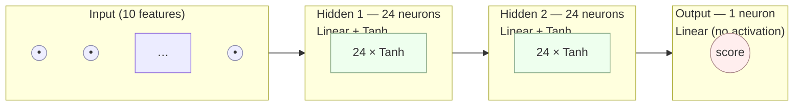
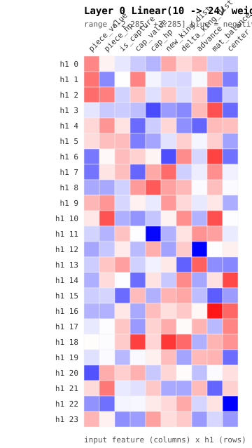
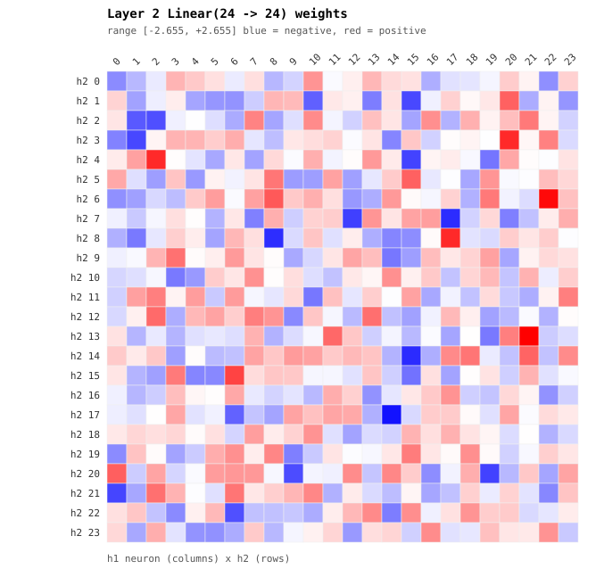
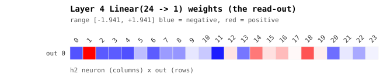
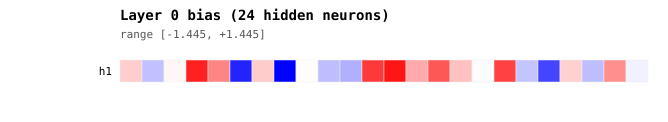
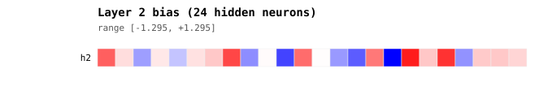

# Chapter 2 — The Neural Network

> **Goal of this chapter:** describe the network *as an artefact* — every
> layer, every neuron, every weight — in complete detail. How it is *trained*
> is Chapter 3; here we dissect the object itself, including a visualisation of
> the actual learned weights from `ai_brain.pt`.

---

## 2.1 What kind of network is this?

It is a **multilayer perceptron (MLP)** — a plain fully-connected feed-forward
network — used as a **move-scoring function**:

$$
f_\theta : \mathbb{R}^{10} \rightarrow \mathbb{R}
$$

It takes a **10-dimensional feature vector describing a single candidate move**
(piece → target tile) and returns **one scalar: the desirability of that
move**. It is *not* a policy network that outputs a probability distribution
over all moves, and *not* a value network that scores board positions.

> **Remember:** the network scores **one move at a time**. To pick a move, the
> policy builds the feature vector for *every* legal (piece, target) pair,
> pushes them all through the network as a batch, and takes the **argmax** of
> the scores. The "decision" is `argmax`, applied outside the network; the
> network only ranks. See Chapter 3 / `NNPolicy.choose` for the loop.

The definition lives in [brain.py](../brain.py):

```python
class Brain(nn.Module):
    def __init__(self, n_in=N_FEATURES, n_hidden=24):
        super().__init__()
        self.net = nn.Sequential(
            nn.Linear(n_in, n_hidden), nn.Tanh(),   # layer 0 + activation
            nn.Linear(n_hidden, n_hidden), nn.Tanh(),  # layer 2 + activation
            nn.Linear(n_hidden, 1),                  # layer 4 (read-out)
        )

    def forward(self, x):
        return self.net(x).squeeze(-1)
```

---

## 2.2 Architecture at a glance



| # | Layer (PyTorch) | Shape | In → Out | Activation | Neurons | Weights | Biases | Params |
|---|---|---|---|---|---|---|---|---|
| 0 | `Linear(10, 24)` | `(24, 10)` | 10 → 24 | Tanh | 24 | 240 | 24 | **264** |
| 1 | `Tanh` | — | 24 → 24 | — | — | 0 | 0 | 0 |
| 2 | `Linear(24, 24)` | `(24, 24)` | 24 → 24 | Tanh | 24 | 576 | 24 | **600** |
| 3 | `Tanh` | — | 24 → 24 | — | — | 0 | 0 | 0 |
| 4 | `Linear(24, 1)` | `(1, 24)` | 24 → 1 | none | 1 | 24 | 1 | **25** |
| | **Total** | | | | **49** | **840** | **49** | **889** |

> **The hard numbers (verified from `ai_brain.pt`):**
> - **Inputs:** 10
> - **Hidden neurons:** 24 + 24 = **48**
> - **Output neurons:** 1 → **49 neurons total** carry weights
> - **Trainable parameters:** **889** (840 weights + 49 biases)
> - **Depth:** 3 linear layers (2 hidden + 1 read-out)
> - **Width:** 24

This is a *tiny* network. At 889 float32 parameters it occupies roughly
**3.5 KB** of weights. That smallness is deliberate — Chapter 3 trains it with
an evolutionary algorithm where parameter count directly drives the search
difficulty, so the model is kept just big enough to express good move
preferences and no bigger.

---

## 2.3 The forward pass, precisely

Let $x \in \mathbb{R}^{10}$ be the feature vector for one candidate move, and
let the parameters be $(W_0, b_0), (W_2, b_2), (W_4, b_4)$ with shapes
$24{\times}10$, $24$, $24{\times}24$, $24$, $1{\times}24$, $1$.

$$
\begin{aligned}
h_1 &= \tanh(W_0 x + b_0) &&\in \mathbb{R}^{24} \\
h_2 &= \tanh(W_2 h_1 + b_2) &&\in \mathbb{R}^{24} \\
s   &= W_4 h_2 + b_4 &&\in \mathbb{R}
\end{aligned}
$$

The output $s$ is the **raw score**. There is **no final activation** — the
read-out is linear, so $s$ is unbounded in $(-\infty, +\infty)$. That is fine
because only the *relative ordering* of scores matters (we take an argmax),
never the absolute magnitude.

### Why `Tanh`?

- It is **zero-centred** and **bounded** in $(-1, 1)$, which keeps hidden
  activations in a stable range across the two layers — important when weights
  are perturbed randomly by mutation (Chapter 3) and we never normalise inputs
  with batch-norm or similar.
- Inputs are already roughly in $[-1, 1]$ (Section 2.4), so a Tanh first layer
  is well matched to the data scale.
- It is smooth and symmetric, so a mutation that flips a weight's sign produces
  a sensible, symmetric change in behaviour — friendly to evolutionary search.

> **Remember:** there is **no softmax and no sigmoid on the output.** The
> network emits a bare score; selection happens via `argmax` over all
> candidate moves. During training a small Gaussian noise is *added to the
> scores* (not inside the net) for exploration — see `NNPolicy(sigma=...)`.

---

## 2.4 The input: a 10-feature move descriptor

Every feature is **hand-engineered** and **pre-normalised to roughly $[-1, 1]$
or $[0, 1]$** so the raw network never sees large magnitudes. The vector is
built in `NNPolicy._features` ([brain.py](../brain.py)). Order matters — it is
the column order in the layer-0 weight heatmap below.

| idx | Feature | Formula (normalised) | Meaning |
|---|---|---|---|
| 0 | `piece_value` | `PIECE_VALUE[name] / 9` | How valuable the moving piece is (Pawn 0.11 … Queen 1.0) |
| 1 | `piece_hp` | `hp / max_hp` | Health fraction of the moving piece |
| 2 | `is_capture` | `1.0 / 0.0` | Does the target tile hold an enemy? |
| 3 | `cap_value` | `PIECE_VALUE[enemy] / 9` | Value of the enemy being captured (0 if none) |
| 4 | `cap_hp` | `enemy.hp / enemy.max_hp` | Health of the capture target (low = finishable) |
| 5 | `new_king_dist` | `new_kd / MAX_DIST` | Manhattan distance to the enemy King *after* the move |
| 6 | `delta_king_dist` | `(cur_kd − new_kd) / MAX_DIST` | How much closer to the enemy King this move gets |
| 7 | `advance` | `forward · (tr − row) / 7` | Forward progress (sign depends on colour) |
| 8 | `mat_balance` | `(my_mat − enemy_mat) / 39` | Global material lead/deficit |
| 9 | `center` | `1 − (|tc−c| + |tr−c|)/MAX_DIST` | Centrality of the target tile |

Constants: `MAX_DIST = 14` (max Manhattan distance on an 8×8 board),
`MAX_MATERIAL = 39`, `CENTER = 3.5`.

> **Design note worth remembering:** features 0–4 are *tactical* (this move,
> this capture), features 5–7 are *positional/aggressive* (king pressure,
> advancement), and features 8–9 are *strategic/global* (material, board
> control). The network's whole job is to learn the **relative weighting** of
> these three pressures — something the fixed heuristic in `ai.py` hard-codes
> ("captures first, then advance").

---

## 2.5 Weight initialisation

There is no custom init. Each `nn.Linear` uses PyTorch's default **Kaiming
uniform** initialisation: weights drawn from
$\mathcal{U}\!\left(-\frac{1}{\sqrt{\text{fan\_in}}}, \frac{1}{\sqrt{\text{fan\_in}}}\right)$
and biases from the same bound. From that random start, **all** subsequent
change comes from evolutionary mutation (additive Gaussian noise), never from
backpropagation — there is no optimiser and no loss function anywhere in the
codebase. (Full mechanism: Chapter 3.)

---

## 2.6 The learned weights — statistics

Measured from the shipped champion `ai_brain.pt`:

| Tensor | Shape | min | max | mean | std |
|---|---|---|---|---|---|
| `net.0.weight` | (24, 10) | −2.285 | 2.082 | −0.018 | 0.816 |
| `net.0.bias` | (24,) | −1.445 | 1.324 | 0.129 | 0.757 |
| `net.2.weight` | (24, 24) | −2.464 | 2.655 | 0.020 | 0.810 |
| `net.2.bias` | (24,) | −1.296 | 1.151 | 0.069 | 0.652 |
| `net.4.weight` | (1, 24) | −1.716 | 1.941 | −0.349 | 0.918 |
| `net.4.bias` | (1,) | −0.078 | −0.078 | −0.078 | — |

> **Reading the stats:** weights are roughly zero-mean with std ≈ 0.8 — much
> wider than the tiny Kaiming init range (≈ ±0.2 for fan-in 10–24). That spread
> is the *fingerprint of evolution*: thousands of small Gaussian mutations
> accumulated into a structured, higher-variance weight field. The read-out
> layer (`net.4.weight`) has a clearly **negative mean (−0.349)**, meaning the
> output neuron *subtracts* from many hidden activations by default — the net
> is biased toward low scores and only specific feature combinations push a
> move's score up.

---

## 2.7 Weight visualisation

The figures below are rendered directly from `ai_brain.pt` by
[assets/visualize_weights.py](assets/visualize_weights.py) (dependency-free
SVG; hover a cell in a browser to read its exact value). **Blue = negative,
red = positive, white ≈ 0**, with the colour scale normalised per matrix.

### Layer 0 — `Linear(10 → 24)`: feature detectors

Each **row** is one of the 24 first-hidden neurons; each **column** is one
input feature. A row is the "receptive field" of that neuron — which features
excite (red) or inhibit (blue) it.



### Layer 2 — `Linear(24 → 24)`: feature mixing

The 24×24 block recombines the first hidden layer into higher-order
move concepts. Rows = output (h2) neurons, columns = input (h1) neurons.



### Layer 4 — `Linear(24 → 1)`: the read-out

A single row of 24 weights collapses the final hidden layer into the scalar
score. Red entries are h2 neurons that *raise* a move's desirability; blue ones
*lower* it.



### Biases





> **Regenerating the figures:** after retraining, run
> `python docs/assets/visualize_weights.py` (optionally pass a brain path) to
> overwrite the SVGs in place.

---

## 2.8 What did the network actually learn? (feature importance)

Two complementary analyses, both computed from the champion weights:

**(a) Linearised influence** — treat the net as if Tanh were the identity, i.e.
collapse it to a single linear map $W_4 W_2 W_0 \in \mathbb{R}^{1\times 10}$.
This is the *signed* first-order pull of each feature near the origin:

| Feature | Linearised influence |
|---|---|
| `center` | **+24.80** |
| `cap_value` | **+23.59** |
| `piece_value` | +20.38 |
| `piece_hp` | **−19.80** |
| `new_king_dist` | +19.50 |
| `cap_hp` | +14.74 |
| `advance` | +13.27 |
| `mat_balance` | +9.30 |
| `is_capture` | +2.47 |
| `delta_king_dist` | +0.71 |

**(b) Mean absolute gradient** — average $|\partial s / \partial x_i|$ over
20,000 random inputs (this *includes* the Tanh nonlinearity, so it captures
realistic sensitivity, unsigned):

| Feature | Mean \|gradient\| |
|---|---|
| `piece_value` | 5.74 |
| `cap_value` | 4.66 |
| `center` | 4.03 |
| `piece_hp` | 3.76 |
| `mat_balance` | 3.35 |
| `new_king_dist` | 2.72 |
| `advance` | 2.14 |
| `delta_king_dist` | 2.10 |
| `cap_hp` | 1.91 |
| `is_capture` | 1.76 |

> **Interpretation — things to remember:**
> - **`cap_value` and `piece_value` dominate both rankings.** The net learned a
>   *material-aware* policy on its own: prize captures of valuable enemies, and
>   weigh the risk of the (valuable) piece doing the moving. It rediscovered the
>   heuristic's "captures first" instinct — without being told.
> - **`piece_hp` has a strong *negative* linear influence.** A healthy moving
>   piece tends to lower the score — plausibly the net prefers committing
>   damaged pieces to attacks (don't risk a fresh piece, or spend a wounded one).
> - **`center` ranks surprisingly high.** Board control / centralisation
>   emerged as a real positional driver, not just tactics.
> - **`is_capture` (the raw 0/1 flag) is nearly irrelevant**, while `cap_value`
>   is huge. The network ignores the blunt "is this a capture?" bit and instead
>   reasons about *which* capture — a more nuanced signal than the heuristic's.

---

## 2.9 Persistence & footprint

| Property | Value |
|---|---|
| On-disk format | PyTorch `state_dict` via `torch.save` (`ai_brain.pt`) |
| Loaded by | `load_brain(path)` → `Brain()` + `load_state_dict`, set to `.eval()` |
| Parameter dtype | `float32` |
| Weight memory | 889 × 4 B ≈ **3.5 KB** |
| Device | CPU (`map_location="cpu"`) |
| Inference cost | One batched matmul over all candidate moves per decision — negligible |

`ai_brain_91.pt` is a frozen backup of the champion that scored **91% vs the
heuristic** at difficulty 10. The game auto-loads `ai_brain.pt` when started
with `--ai`, falling back to the heuristic if the file (or torch) is absent.

> **Remember:** because the same `Brain` class and the same 10-feature contract
> are used in training and in play, a saved `.pt` is *directly* playable — no
> conversion, no export step. Drop in a new `ai_brain.pt` and the game uses it.

---

Continue to **Chapter 3** for how these 889 numbers were found: the
evolutionary self-play loop, mutation, the champion gate, and why naïve
self-play quietly destroys the model.
