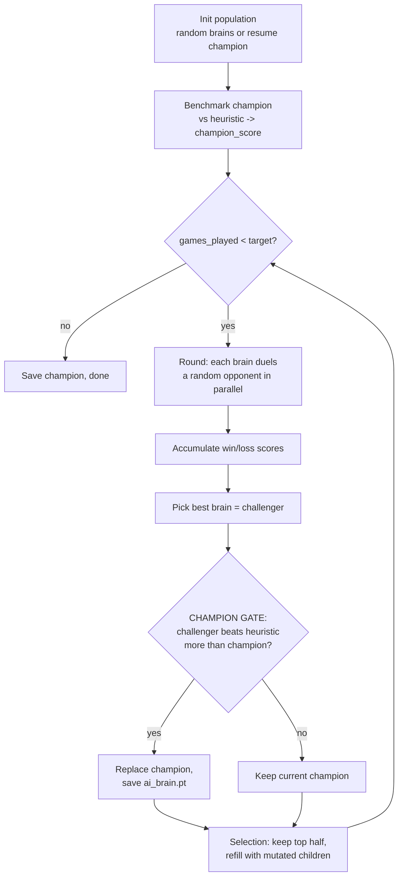

# Chapter 3 — The Machine Learning Engine

> **Goal of this chapter:** explain how the 889 weights from Chapter 2 are
> *found*. There is no dataset, no labels, no gradient descent. The brain is
> trained by **neuroevolution with self-play**, anchored to a fixed benchmark
> by a mechanism called the **champion gate**. That gate is the single most
> important idea in the whole pipeline — without it the model *regresses*.

---

## 3.1 The paradigm: neuroevolution, not backprop

The entire learning method is in [train.py](../train.py). It uses **none** of
the usual deep-learning machinery:

| Usual supervised / RL setup | This project |
|---|---|
| Labelled dataset or reward signal | **None** — only game outcomes (win/loss/draw) |
| Loss function | **None** |
| Gradients / backpropagation | **None** |
| Optimizer (SGD, Adam) | **None** |
| Parameter update | **Gaussian mutation of weights** |
| Selection signal | **Did this brain win games?** |

This is a **genetic algorithm / evolution strategy** over the network weights.
A *population* of brains plays games against each other; the winners survive and
spawn slightly-mutated children; repeat. Over many generations the population
drifts toward weights that win.

> **Remember:** "training" here means *survival of the fittest network*. The
> only thing that flows back into the weights is the random mutation noise of
> the brains that happened to win. No derivative is ever computed.

---

## 3.2 The genetic operators

All three operators live in [brain.py](../brain.py):

```python
def clone_brain(brain):           # exact copy (state_dict transfer)
def mutate(brain, sigma):         # clone, then add N(0, sigma^2) to EVERY weight
def save_brain / load_brain       # persistence
```

**Mutation** is the heart of the search:

```python
def mutate(brain, sigma):
    child = clone_brain(brain)
    with torch.no_grad():
        for p in child.parameters():
            p.add_(torch.randn_like(p) * sigma)   # additive Gaussian noise
    return child
```

Every one of the 889 parameters gets an independent perturbation
$\Delta\theta_i \sim \mathcal{N}(0, \sigma^2)$, with default $\sigma = 0.15$.
This is **uncorrelated isotropic Gaussian mutation** — the simplest possible
evolution-strategy move operator.

> **Remember:** `sigma` is the *mutation strength* — the step size of the
> search. Too small and evolution stalls; too large and good brains get
> scrambled. 0.15 is the tuned default. A *separate* noise, `explore` (default
> 0.05), is added to **move scores** at play time (`NNPolicy(sigma=explore)`)
> so that even a fixed brain explores different moves during training games.

---

## 3.3 One game, headless and fast

`play_game(brain_white, brain_black, ...)` runs the real game simulation with
**no Pygame, no rendering**, at a large fixed timestep so simulated time
fast-forwards:

| Knob | Value | Why |
|---|---|---|
| `SIM_DT` | 1.0 | Big timestep → each step advances a lot of game-time |
| `MAX_STEPS` | 250 | Hard cap so a game always terminates |
| `TRAIN_APS` | 99.0 | Action rate so high every idle piece is commanded instantly |

Each step it ticks both AI controllers, resolves combat, and updates every
piece — exactly the same functions the live game uses (`process_combat`,
`piece.update`). Termination:

1. A King dies → that side loses (or both die same step → draw).
2. Otherwise, after 250 steps, **decide by remaining material**; equal → draw.

The whole function is wrapped in `@torch.no_grad()` — there are no gradients to
track, so this saves time and memory.

> **Remember:** the trainer reuses the *production* game logic. There is no
> separate "training environment" that could drift from real play — the brain
> is evaluated on exactly the rules it will face in the game.

A **duel** wraps `play_game` and randomises which colour each brain plays, so a
brain can't win merely by always being white:

```python
def duel(brain_a, brain_b, sigma):
    # 50/50 swap colours; return +1 if a wins, -1 if b wins, 0 draw
```

---

## 3.4 The generational loop



Per generation:

1. **Round.** Each of the `pop_size` brains duels one *random* opponent.
   Winner of each duel: `scores[i] += outcome`, `scores[j] -= outcome`.
2. **Selection.** Sort by score; keep the **top half** as survivors; refill the
   population with **mutated children** of randomly chosen survivors.
3. **Gate** (next section) decides whether the generation's best brain is
   promoted to champion and written to disk.

Defaults: `pop_size = 8`, `sigma = 0.15`, `explore = 0.05`,
`total_games = 1000`.

---

## 3.5 The champion gate — the crucial idea

> **This is the most important section in the document.**

Naïve self-play has a notorious failure mode. If you simply keep "whoever beats
the current population," the population **co-evolves to beat itself**, not to
play well. It chases a moving target (its own siblings) and can drift into
strategies that crush its relatives while playing *worse* against any fixed,
real opponent. This is the **Red Queen problem** — running hard just to stay in
place, or worse, sliding backwards.

> **Documented evidence in this repo:** a pure self-play resume run of +1000
> games once dropped the brain from **91% → 45%** against the heuristic. An
> earlier head-to-head "best-of-3 playoff" selection was the culprit. Self-play
> *without an external anchor regresses.*

The fix is the **champion gate**. Selection *within* the population is still by
self-play, but the **champion** (the brain saved to disk and shipped to the
game) is only ever replaced when it beats a **fixed external benchmark** — the
built-in heuristic AI — *more often than the current champion does*.

```python
ch_score = score_vs_heuristic(challenger, eval_games, eval_difficulty, executor)
if ch_score > champion_score:
    champion = clone_brain(challenger)
    champion_score = ch_score
    save_brain(champion, out_path)        # only now does ai_brain.pt change
```

`score_vs_heuristic` plays `eval_games` (default **8**) games against the
heuristic at `eval_difficulty` (default **10**), **alternating colours**, and
returns a score rate in $[0,1]$ (a draw counts as 0.5).

> **Why this works — remember this:**
> - The heuristic is **fixed**. It never co-evolves, so it is a *stable ruler*.
> - The champion's score against that ruler is **monotonic by construction** —
>   it can only be replaced by something that measures *better*. **The shipped
>   model therefore cannot regress.**
> - Self-play still provides the *variation* and *pressure* that generate strong
>   challengers; the gate just decides which challengers are allowed to become
>   the official model.

This is a form of **quality-diversity / benchmark-anchored evolution**: explore
freely via self-play, but only commit improvements that prove themselves
against an immovable standard.

---

## 3.6 Parallel training

Brains are cheap to evaluate but you want many games, so duels and gate-games
run across processes via `ProcessPoolExecutor`:

- Brains can't be shared across processes cheaply, so each task **ships the
  brain's `state_dict`** (`_brain_state`) and the worker **rebuilds the
  network** (`_brain_from_state`).
- Each worker calls `torch.set_num_threads(1)` to avoid thread
  oversubscription (many processes × many threads = contention).
- Workers seed their own RNG for reproducible, independent randomness.
- `--workers N` controls the pool (default = `os.cpu_count()`, here 8; `1`
  disables multiprocessing).

> **Throughput note:** only `pop_size` duels run per round, so to saturate all
> cores use a large population (e.g. `--pop 32`), which reaches ~31 games/s.
> 1000 games take ~60 s single-threaded vs ~17 s multi-threaded. Use `-u` when
> redirecting logs so output isn't block-buffered.

---

## 3.7 Resuming and seeding

```bash
python train.py --resume --games 1000
```

`--resume` loads `ai_brain.pt`, makes it the champion *and* the seed of a fresh
population (`champion` + `pop_size − 1` mutated copies), and **re-benchmarks it
against the heuristic at startup** so the gate has the correct bar to clear.
Without `--resume`, the population starts from random brains.

> **Remember:** because the gate re-benchmarks on resume and only saves
> improvements, repeated `--resume` runs are safe — they can extend a champion
> but, by construction, **cannot ship a worse one**.

---

## 3.8 Evaluation

[eval.py](../eval.py) is the standalone, honest scorecard — the same
`play_vs_heuristic` logic as the gate, but run over many games for a
statistically meaningful number:

```bash
python eval.py --games 100 --difficulty 10
```

It plays N games (colours alternated for fairness) and reports wins / losses /
draws, win rate, score rate, and decided-game win rate.

**Headline result:** the shipped champion (`ai_brain_91.pt`, a 1000-game run)
beats the heuristic AI at maximum difficulty (10) about **91% of the time**.

---

## 3.9 Hyperparameter reference

| Flag / constant | Default | Meaning |
|---|---|---|
| `--games` | 1000 | Total self-play games (training budget) |
| `--pop` | 8 | Population size |
| `--sigma` | 0.15 | Mutation strength (Gaussian std on weights) |
| `--explore` | 0.05 | Score noise during training games (exploration) |
| `--eval-games` | 8 | Games vs heuristic per champion-gate check |
| `--eval-difficulty` | 10 | Heuristic difficulty used by the gate |
| `--workers` | CPU count | Parallel worker processes (1 = serial) |
| `--resume` | off | Continue from existing `ai_brain.pt` |
| `--seed` | none | RNG seed for reproducibility |
| `SIM_DT` | 1.0 | Headless simulation timestep |
| `MAX_STEPS` | 250 | Max steps before deciding by material |
| `TRAIN_APS` | 99.0 | Actions/sec during training (act every step) |

---

## 3.10 Things to remember (the whole pipeline in one box)

> 1. **No gradients.** The model is trained by **neuroevolution**: mutate
>    weights with Gaussian noise, keep the winners.
> 2. **Self-play creates pressure**, but on its own it **regresses** (Red Queen
>    / co-evolution). Proven here: 91% → 45% once.
> 3. **The champion gate fixes it.** The shipped brain only changes when it
>    beats a *fixed* heuristic benchmark better than before → it **cannot
>    regress**.
> 4. **Same code everywhere.** Training reuses the production game logic, and a
>    trained `.pt` drops straight into the game.
> 5. **Tiny & fast.** 889 parameters, headless fast-forward sim, multiprocess
>    duels → a strong (≈91% vs heuristic) brain in ~minutes.
